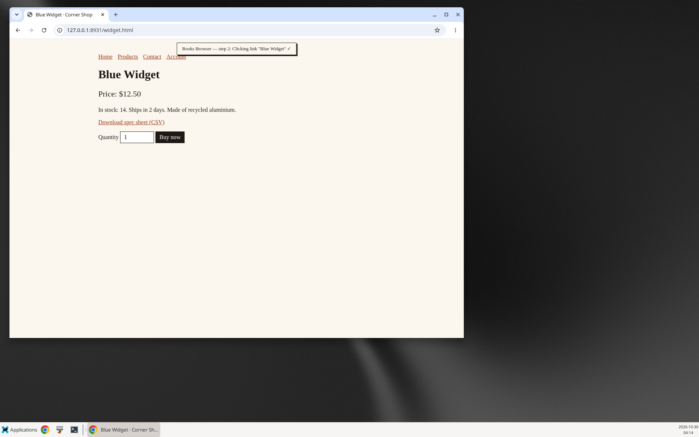
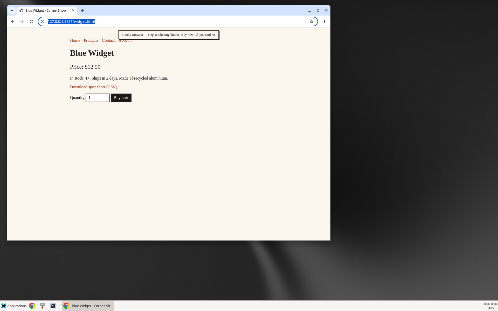

# Rooks Browser

Give it a task in plain English and watch it use a real browser. Rooks Browser is a small, local-first browser agent for
AI Workspace. It works with OpenAI, Anthropic, OpenRouter, Ollama, any OpenAI-compatible server, or the models you have
connected in Workbench. It drives your own Chrome or Edge through Playwright, so you don't need a multi-gigabyte image.

```
$ rooks-browser -P ollama -m qwen2.5:7b --start-url http://127.0.0.1:8931/index.html \
    "Use the links on this shop's site: go to its products, open the Blue Widget and tell me its price and stock."
Rooks Browser 0.1.0 · ollama · headed
   1. Clicking link "Products"
      ✓ clicked, now at http://127.0.0.1:8931/products.html
   2. Clicking link "Blue Widget"
      ✓ clicked, now at http://127.0.0.1:8931/widget.html
   ...
Answer (the agent's own claim; check it against the pages visited):
Price: $12.50, In stock: 14
5 steps · 47.3s · 3 pages · tokens 4621+169
```

That is a real run on a laptop-class CPU with a local 7B model ([full log](docs/demo-ollama.txt)). While it works, a small
banner in the page says what it is doing, and it outlines the element it is about to use:



## Install

You need Python 3.11+ and either Google Chrome, Microsoft Edge, or Playwright's bundled Chromium.

```
uv tool install ./rooks-browser          # or: pipx install ./rooks-browser, or pip install -e rooks-browser
rooks-browser doctor                     # what it found: browsers, models, search, install size
```

When Chrome or Edge is already installed, nothing else gets downloaded. If neither is installed, run
`python -m playwright install chromium` (add `--with-deps` on Linux servers).

| | Install size |
| --- | --- |
| Rooks Browser with your Chrome or Edge | ≈ 140 MB (Playwright's Python package and driver; a fresh venv measured 140 MB) |
| … plus Playwright's own Chromium | + ≈ 400 MB on Linux (+ ≈ 270 MB for the headless shell) |
| The `browser` add-on (browser-use image) | ≈ 2.5 GB |

The only dependency is Playwright. Model calls, the HTTP API and the MCP server use the standard library.

## Use

```
rooks-browser "find the opening hours of the State Library of Queensland"
rooks-browser -P anthropic "compare the two cheapest 27-inch 4K monitors on example-shop.com"
rooks-browser -P openrouter -m deepseek/deepseek-chat --allow '*.wikipedia.org' "who designed the Story Bridge?"
rooks-browser --headless --json "…"          # no window; machine-readable result
rooks-browser search "query"                 # one search, no model
rooks-browser read https://example.com       # one page's text and links, no model
```

The window opens when there's a display (`--headed` / `--headless` override that). `--browser chrome|msedge|chromium`
picks the engine. `--cdp http://localhost:9222` attaches to a Chrome you started yourself with
`--remote-debugging-port=9222`. When it attaches, it opens its own tab and closes only that tab.

**Models.** `-P` takes `openai`, `anthropic`, `openrouter`, `ollama`, `openai-compatible` (with `--base-url`), `workbench`
or `auto`. `auto` picks Workbench, then Anthropic, OpenAI, OpenRouter, and finally a local Ollama, using whichever keys
are in the environment (`ANTHROPIC_API_KEY`, `OPENAI_API_KEY`, `OPENROUTER_API_KEY`, `WORKBENCH_URL`).
`ROOKS_BROWSER_PROVIDER` and `ROOKS_BROWSER_MODEL` set the defaults.

**How it sees the page.** Each step, the model gets a numbered list of the page's interactive elements (role, name,
link target, form flags) plus the page's text. Vision models also get a screenshot: Claude, GPT-4o/4.1/5, Gemini, and
`-vl`/llava-style local models. Override that with `--vision on|off`. Text-only models work from the list alone.

**Actions:** search (SearXNG when `SEARXNG_URL` is set, else a search page in the browser), open, click, type, select,
scroll, extract (full page text), download, back, handoff (asks you to do a step yourself, such as logging in), and done.

**Small models.** In testing, qwen2.5:7b followed explicit instructions well (the log above). Given an open-ended task
("find the Blue Widget in the shop"), it searched the whole web instead of using the shop's own links
([log](docs/demo-ollama-open-web.txt)). Claude, GPT and Gemini are much better at open-ended tasks. The final answer is
always labelled as the agent's own claim, and the visited URLs and the receipt show what it actually did.

## Trust

* **You see every action.** Each step prints what it is about to do, and in a headed window a banner and an outline
  show it on the page.
* **It asks before anything that acts for you:** submitting a form, buying (including typing into card fields),
  sending a message or posting, and logging in. Answer `y` in the terminal, in the Workbench Browser page, or in
  your MCP client. With no way to ask, the answer is no.
  * `--approve submit,purchase,message` pre-approves categories for one run. `all` never includes logins.
  * `--ask download` also asks before downloads. By default, downloads are saved to a folder and never opened.
  * If you say no, it stops after a few more steps instead of looking for another way round.

  
* **It never stores or types passwords.** Every run uses a fresh, throw-away browser profile. It refuses to type into
  password fields and hands that step to you (`handoff`) in the visible window.
* **Per-site allow and deny lists:**
  * `rooks-browser sites allow example.com` / `deny ads.example.com` / `remove …` / `list`. These are kept in
    `sites.json`.
  * `--allow` and `--deny` apply to one run.
  * Patterns like `*.example.com` work. Deny wins.
  * Checks run in the browser itself, so links, redirects, typed URLs and new tabs are all covered. Pages and
    resources from denied sites never load.
* **It treats page text as data.** The model is told that instructions inside web pages are not from you, and the
  tests include a page with a hidden prompt-injection.
* **Every visited URL is logged.** Receipts use the same row format as Workbench's run log (`turn`, `model_call`,
  `tool_call`, `decision`, `egress`). Egress rows hold the method, host and path, never the query string. Text is
  redacted with Workbench's own redaction rules.
  * `rooks-browser receipts list` / `show [session]` shows them.
  * `rooks-browser receipts import --db workbench.db` copies them into Workbench's Audit, or use
    `--workbench-db PATH` to write them live.
  * Files live in `runs/` under `ROOKS_BROWSER_HOME`. The default is `~/.local/share/ai-workspace/rooks-browser`,
    `~/Library/Application Support/…` on macOS, or `%APPDATA%\ai-workspace\rooks-browser` on Windows.
* **Captchas are left to you.** If a search page shows a human check, Rooks Browser says so and doesn't try to get past
  it. Use SearXNG (the `search` add-on) for search in headless runs.

## Three ways to call it

**CLI**, as above.

**Local HTTP API** for Workbench and other apps:

```
rooks-browser serve                                   # http://127.0.0.1:8765, this computer only
ROOKS_BROWSER_TOKEN=$(openssl rand -hex 24) rooks-browser serve --host 0.0.0.0 --block-private
```

It speaks the same job API as the `browser` add-on: `GET /api/providers`, `POST /api/jobs {goal, provider, model,
max_steps, allowed_domains, start_url}`, `GET /api/jobs[/{id}]`, `GET /api/jobs/{id}/screenshot`,
`POST /api/jobs/{id}/cancel` and `DELETE /api/jobs/{id}`. On top of that it adds:

* `GET /api/jobs/{id}/approvals` and `POST /api/jobs/{id}/approvals/{approval_id} {"approve": true}`. A job waiting for
  you shows `pending_approvals`, and no answer within 10 minutes counts as a no.
* `GET /api/jobs/{id}/receipt`, `POST /api/read {url}` and `POST /api/search {query}`.
* A job may carry `approve: ["submit", …]`, the same as `--approve` on the command line. Only send it from something
  acting on your explicit say-so, such as a button you pressed. Workbench's chat tool never sends it.

To use it from Workbench instead of the `browser` add-on, start it with a token on `0.0.0.0` and set
`BROWSER_URL=http://host.docker.internal:8765` and `BROWSER_API_KEY=<the same token>` in `.env`. Workbench's Browser page
and the chat `browse_web` tool then use it as-is. Start the server with `WORKBENCH_URL=http://localhost:3100` in its env: jobs with `provider: "workbench"` call
`WORKBENCH_URL/v1` with `BROWSER_API_KEY`, so they run on your Workbench model connections and show up in its usage.

Without a token, the server answers only requests addressed to localhost, which stops web pages from reaching it through
DNS rebinding. It refuses to listen beyond this computer without a token of 24+ characters.

**MCP server** for Rooks Code, Claude Code, Codex, Cursor and others: `rooks-browser mcp` (stdio). It offers three tools:
`browse_web`, `read_page` and `web_search`.

```
claude mcp add rooks-browser -- rooks-browser mcp
# ~/.codex/config.toml
[mcp_servers.rooks-browser]
command = "rooks-browser"
args = ["mcp"]
```

When the client supports MCP elicitation, approvals are asked in the client. Otherwise, sensitive actions are refused
and reported, because the calling agent can't approve on your behalf. To let it, set `ROOKS_BROWSER_MCP_PREAPPROVE=1` in
the server's env; `browse_web` then takes an `approve` argument (never for logins). `ROOKS_BROWSER_HEADED=1` shows the
window.

## Develop

```
cd rooks-browser && uv venv && uv pip install -e ".[dev]" && .venv/bin/python -m pytest -q
```

The tests drive a real browser against a local test shop (`tests/site/`) with a scripted model:

* buying with and without approval
* messages and logins
* passwords never typed
* allow and deny lists, redirects and typed URLs
* prompt injection
* search through a fake SearXNG and through a search page
* captcha pages
* downloads, scrolling, vision screenshots
* the HTTP API, including approvals over HTTP, tokens and Host checks
* the MCP server as a subprocess, with elicitation
* the request formats for each model provider
* receipts imported into a real Workbench schema

`ROOKS_BROWSER_TEST_ENGINE=chromium` uses Playwright's Chromium (CI does this on Linux, macOS and Windows).

## Limits

* The element list covers the main frame only, so elements inside iframes (some payment and login widgets) aren't
  numbered. Their text isn't read either.
* The DuckDuckGo fallback search often shows a captcha to headless browsers. Use SearXNG for headless and server runs.
* `--block-private` checks hostnames and literal IPs. A public name that resolves to a private address is not caught.
* Small local models are unreliable on open-ended tasks. See above.
* It has been run on Linux (headless and headed, Chrome 156 and Playwright Chromium). macOS and Windows are covered by
  CI only.
